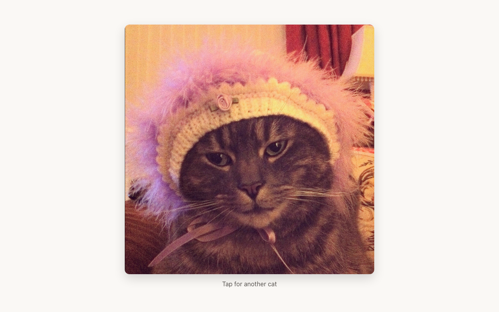
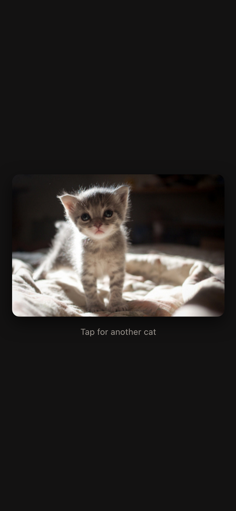

# catsx — Random Cat

一个极简的「随机猫图」网页：点一下换一张。纯静态资源，托管在 Cloudflare Workers（Assets）。

- 线上地址：https://catsx.cfd/ （备用：https://nameless-math-d487.onfd.workers.dev/）
- 数据来源：[TheCatAPI](https://thecatapi.com/)




## 文件

| 文件 | 说明 |
| --- | --- |
| `public/index.html` | 页面（内联 CSS/JS，无构建步骤） |
| `public/robots.txt` | 站点 robots |
| `wrangler.jsonc` | Workers 部署配置（静态资源目录 `./public`） |

## 特性

- 深色模式（`color-scheme` + `light-dark()`，跟随系统）
- 原生 `<progress>` 加载指示，尊重 `prefers-reduced-motion`
- 先预加载并 `decode()` 再交叉淡入，避免白屏；画框按图片比例预留空间，无布局位移
- 请求超时 + 失败重试、预取下一张
- 键盘可操作、可访问名称、错误状态播报
- 首图 `fetchpriority="high"` + `preconnect`，减少首屏等待

## 部署

```sh
wrangler deploy
```

需要本机已登录 Cloudflare（`wrangler login`），并在账号下有同名 Worker `nameless-math-d487` 及自定义域 `catsx.cfd`。
